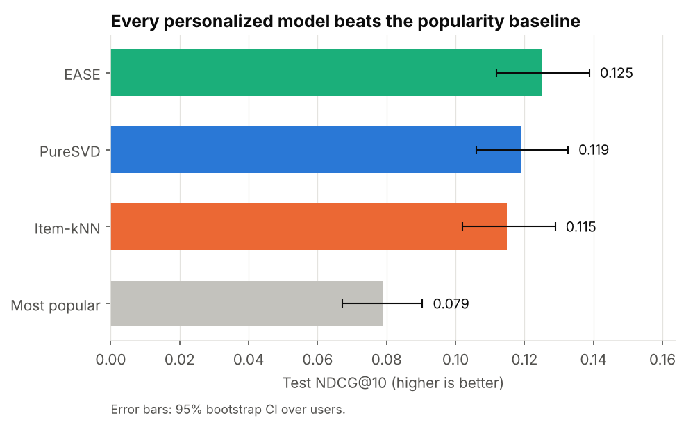
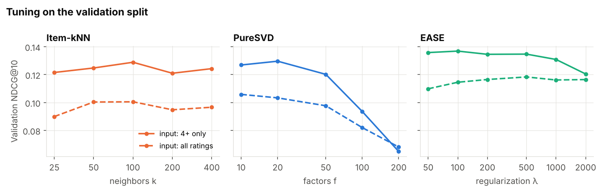

# Movie Recommender: What Should This User Watch Next?

A top-10 movie recommender built and evaluated the way recommendation teams do it: a time-based split, ranking metrics, a popularity baseline to beat, statistical tests between models, and checks beyond accuracy (catalog coverage and popularity bias).

**Data:** MovieLens, with 100,836 ratings from 610 users on 9,724 movies (1996–2018).



## Results

Each model was tuned on a validation split, then evaluated once on each user's most recent 20% of ratings. A "hit" is a recommended movie the user went on to rate 4 stars or higher.

| Model | Precision@10 | Recall@10 | NDCG@10 | Users with ≥1 hit | Catalog coverage | Avg. popularity of recs |
|---|---|---|---|---|---|---|
| **EASE** | **0.098** | **0.102** | **0.125** | **49.6%** | 12.1% | 137 |
| PureSVD | 0.090 | 0.096 | 0.119 | 48.4% | 10.7% | 142 |
| Item-kNN | 0.091 | 0.094 | 0.115 | 46.2% | 13.3% | 135 |
| Most popular (baseline) | 0.060 | 0.053 | 0.079 | 32.2% | 2.2% | 212 |

**Key findings**
- **Personalization pays off:** the best model (EASE) scores **1.58× the popularity baseline** on NDCG@10 and gives half of users at least one hit in their top 10.
- **EASE wins, but not decisively.** A paired bootstrap over users shows EASE significantly beats Item-kNN (+0.010, 95% CI [+0.003, +0.018]) but **not** PureSVD (+0.006, CI [−0.002, +0.014]). In practice that tips the choice toward cost: PureSVD is much cheaper to train and serve at scale.
- **Train on what people liked:** using only 4+ star ratings as input beat using all ratings for every model.
- **Light users are different:** for users with short histories (16–36 ratings), PureSVD edges out EASE (0.105 vs 0.100), a case for blending models by history length.
- **Less popularity bias:** personalized models recommend less mainstream movies and cover 5–6× more of the catalog than the popular list.

## Models

| Model | Idea |
|---|---|
| **Most popular** | Same list for everyone: the baseline to beat |
| **Item-kNN** | "People who liked X also liked Y" (cosine similarity, top-*k* neighbors) |
| **PureSVD** | Matrix factorization with a truncated SVD into *f* latent "taste" dimensions |
| **EASE** | Linear autoencoder (Steck, 2019): closed-form ridge regression predicting each movie from all others |

All four are implemented from scratch with NumPy/SciPy in [`src/recsys.py`](src/recsys.py), with a shared `fit` / `score` interface.

## Evaluation design

- **Per-user time split:** each user's latest 20% of ratings are the test set, and the 20% before that is the validation set. This predicts what users watch *next*, instead of letting models learn from a user's future the way a random split would.
- **Ranking metrics at 10:** precision, recall, NDCG (main metric), hit rate, plus catalog coverage and the average popularity of recommended movies.
- **Already-rated movies are never recommended.** Candidates are movies with at least 3 training ratings; about 14% of test hits fall outside that set and can't be recommended by any model (the cold-start problem).
- **Paired bootstrap** (2,000 resamples of users) to check whether differences between models are real.



## Limitations

- **Offline metrics understate real performance:** an unrated movie isn't necessarily a bad recommendation. The real test is an online A/B test on engagement.
- **The per-user split lets models see a little of the global future** (other users' later ratings). A global time cutoff would be stricter but leaves few test users in a dataset this small.
- **No content features,** so new and rarely rated movies can't be recommended. Genres, tags or descriptions would help.

## Repository structure

```
movie-recommender/
├── data/ml-latest-small/     # MovieLens data + its original README (license terms)
├── notebooks/
│   └── movie_recommender.ipynb   # full analysis with outputs
├── src/recsys.py             # split, 4 models, recommend(), ranking metrics
├── tests/test_recsys.py      # unit tests (split, no seen items, metrics by hand, model sanity)
├── reports/figures/
└── requirements.txt
```

## How to run

```bash
git clone https://github.com/kennethpangestu/movie-recommender.git
cd movie-recommender
python -m venv .venv && source .venv/bin/activate   # Windows: .venv\Scripts\activate
pip install -r requirements.txt

pytest
jupyter lab notebooks/movie_recommender.ipynb
```

The full notebook runs in under a minute on a laptop.

## Data and license

MovieLens `ml-latest-small` from GroupLens Research, University of Minnesota, redistributed here under its original license terms (see [`data/ml-latest-small/README.txt`](data/ml-latest-small/README.txt)). Non-commercial use only; no endorsement by the University of Minnesota or GroupLens is implied.

> F. Maxwell Harper and Joseph A. Konstan. 2015. The MovieLens Datasets: History and Context. *ACM Transactions on Interactive Intelligent Systems* 5, 4: 19:1–19:19. https://doi.org/10.1145/2827872

Steck, H. 2019. Embarrassingly Shallow Autoencoders for Sparse Data. *The Web Conference (WWW)*.
